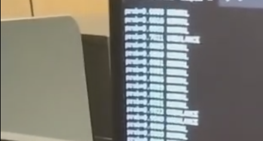

# N20 Vibration Anomaly Detection (TinyML on ESP32-S3)

> ⚠️ **版权与商业声明**
> 本仓库为**技术展示仓库**，用于展示系统架构与硬件通信方案。
> **为了维护商业版权，ESP-DSP 动态 FFT 核心特征提取算法、神经网络模型（.tflite）及完整训练数据集未在此仓库公开。**
> 如需获取【完整工程源码 + 99.91% 模型 + 数据集 + 部署文档】，请通过闲鱼或邮箱联系作者。

## 📖 项目简介
基于 ESP32-S3 和 ADXL345 的高频振动异常检测系统。在本地实现 1600Hz 采样、本地推理，并在 0.96" OLED 上显示实时动态频谱。

## 🎬 效果展示

## 🧠 为什么不开源核心算法？
本系统解决了 CNN 跑原始波形准确率低（84%）、固定转频导致虚警、FFT 频谱泄漏等 3 大痛点，最终实现了 **99.91%** 的高精度识别。由于算法经过大量数据标定，核心特征工程作为商业交付件提供。

## 🛠️ 硬件架构
*   **主控**：ESP32-S3
*   **传感器**：ADXL345 (SPI 模式, FIFO 1600Hz)
*   **显示**：0.96" SSD1306 OLED (I2C)

## 📂 公开代码说明
*   `receive_with_infer.py`：PC 端上位机接收脚本（含二进制协议解析）。
*   `src/main_demo.cpp`：ESP-IDF 工程框架及驱动伪代码。
*   `二进制协议.txt`：串口数据传输协议定义。

## 📬 获取完整商业版本 / 毕设代做
提供全套交付件：
1. ESP-IDF 完整源码（含 FFT 特征提取与 TFLite 接入）。
2. 99.91% 准确率模型（`.h5` 与 `.tflite`）。
3. 6组正常 + 6组不平衡的高频 CSV 原始数据集。
4. 详细的环境搭建与烧录文档。

**联系方式**：[闲鱼链接] / 邮箱 `your_email@example.com`

---
*如果觉得这个项目有商业潜力，欢迎点个 Star ⭐！*
